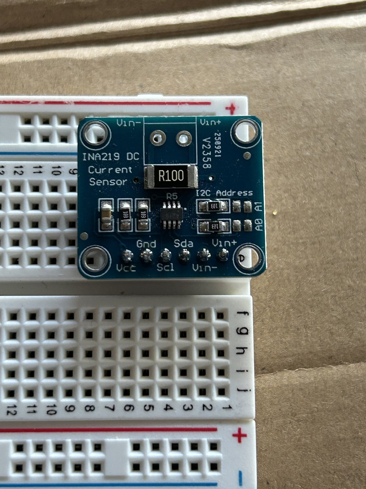
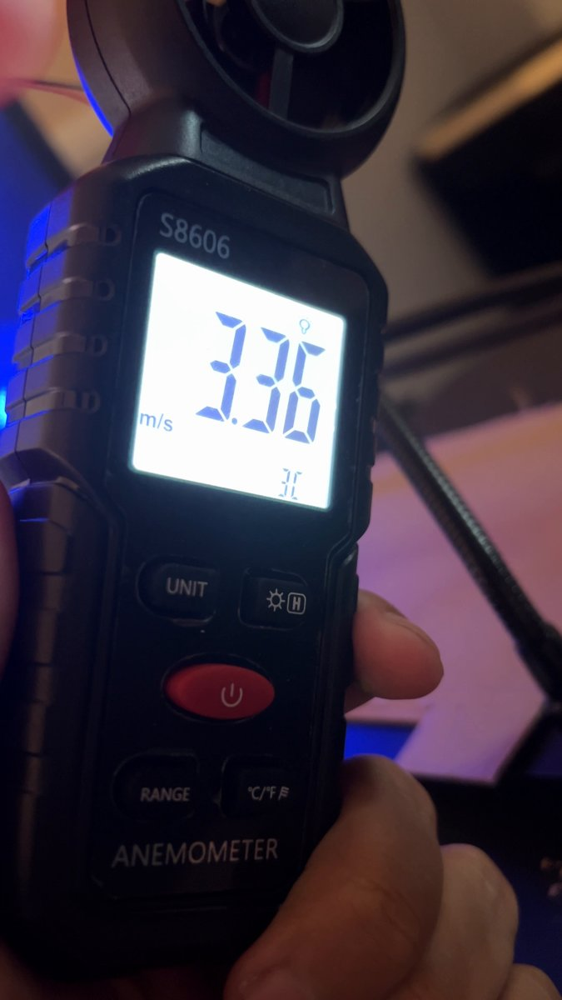
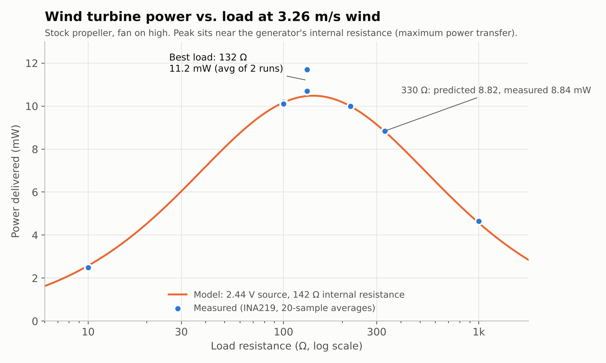
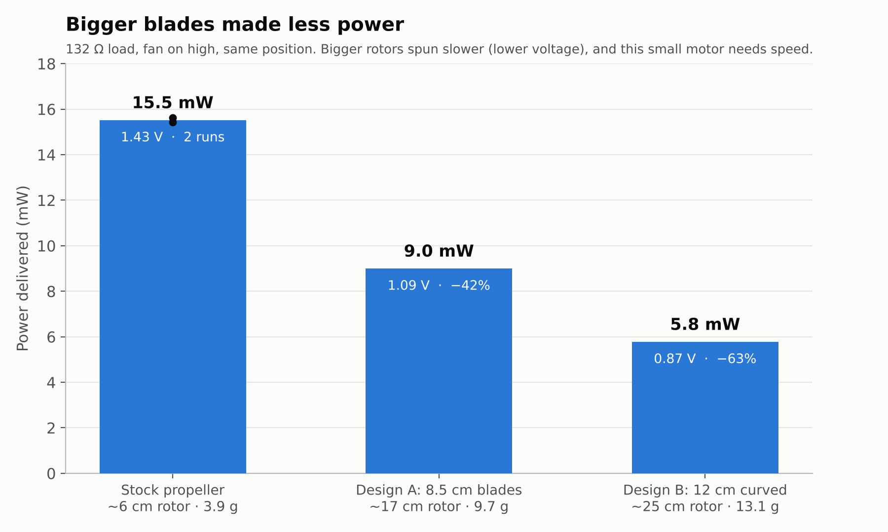
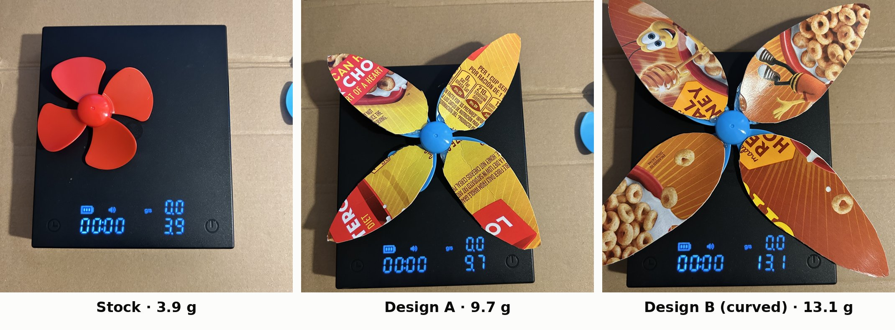
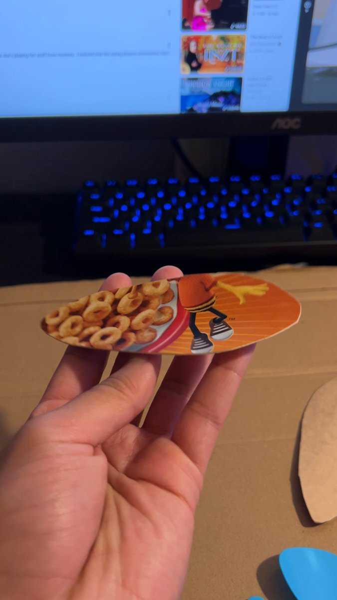
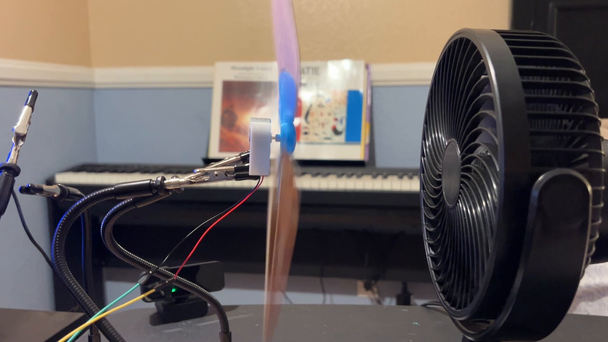
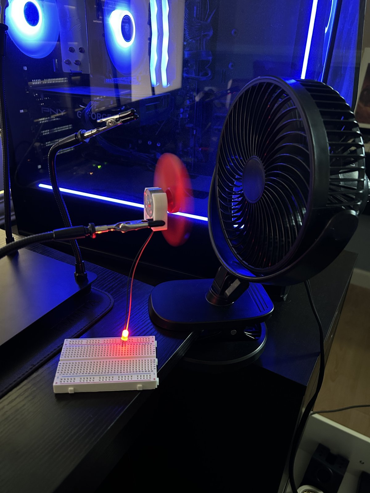

# Wind Power Station

A small wind turbine rig I built to measure how much power a DC-motor generates, find the best resistacnce to maximize the power, and test whether bigger blades create more power.   

*Desk fan, DC motor generator held in helping hands, INA219 sensor on a breadboard, Arduino Mega logging the data.*

## Key results

- **Built a model of the generator and confirmed it.** From two measurements I modeled the generator as a 2.44 V source with 142 Ω of internal resistance. It predicted the power at four new loads within 0.2–6% before I measured them, and correctly predicted the best load (132 Ω).
- **Turbine placement raised power about 40%.** Due to the small ring of the fan's blade, moving the turbine higher instead of centered with the fan took the stock propeller from generating 11mW to 15.5mW.
- **Bigger blades made 42–63% less power.** Larger, heavier cardboard rotors spun slower, decreasing the overall power. P = V²/R explains the drop exactly. Real turbines solve this with a gearbox.

## Hardware

| Part | Purpose |
|---|---|
| Small DC motor (EUDAX kit) | Generator |
| Stock 4-blade propeller (~6 cm) and cardboard blade designs | Rotors |
| INA219 current/voltage sensor (header pins soldered by me) | Measures voltage, current, and power |
| Arduino Mega 2560 | Reads the sensor and logs data |
| Resistors (10 Ω to 1 kΩ) and a red LED | Electrical loads |
| KAIWEETS HT118A multimeter | Cross-checking the sensor |
| S8606 handheld anemometer | Wind speed |
| Clip-on desk fan | Wind source |

### Wiring

*The INA219 after I soldered its header pins.*

| INA219 pin | Connects to |
|---|---|
| Vcc | Mega 5V |
| Gnd | Ground rail |
| Scl | Mega pin 21 (SCL) |
| Sda | Mega pin 20 (SDA) |
| Vin+ | Motor wire 1 |
| Vin− | Load (resistor or LED) |

The load's other end, the motor's other wire, and the Mega's GND all connect to the shared ground rail. Current flows motor → Vin+ → sensor → Vin− → load → ground.

### Code
[`ina219_logger.ino`](ina219_logger.ino) averages 20 readings per line and prints voltage, current, and power about twice a second. I switched the INA219 to its 16 V / 400 mA calibration because the default range reported power in coarse 2 mW steps, too rough for a turbine that makes about 10 mW.

## Method

-With the fan speed turned on high, the wind speed at the turbine is **3.26 m/s** (low setting: 2.71 m/s), averaged from handheld anemometer readings.

- For control, the turbine is kept 4 in. from the fan with the fan pointed straight and room ceiling fan off to avoid noise in the data.
- Each data point is the average of about 20 lines from the logger (each line is itself a 20-sample average).
- Repeatability checks: I re-ran a reference measurement at the end of each session to remain controlled. The start and end matched within 1–1.2%.

## Experiment 1: Finding the best load

With the stock propeller, I connected different resistors and measured the power delivered to each.

| Load | Voltage | Current | Power | Model prediction |
|---|---|---|---|---|
| 10 Ω | 0.161 V | 15.45 mA | 2.49 mW | 2.58 mW |
| 100 Ω | 1.005 V | 10.06 mA | 10.2 mW | (used to build the model) |
| **132 Ω** (220 ∥ 330) | 1.21 V | 9.21 mA | **11.2 mW** (2 runs) | 10.5 mW |
| 220 Ω | 1.482 V | 6.73 mA | 10.0 mW | (used to build the model) |
| 330 Ω | 1.709 V | 5.16 mA | 8.84 mW | 8.82 mW |
| 1 kΩ | 2.166 V | 2.14 mA | 4.64 mW | 4.57 mW |

**What I found**
- **Ohm's law check:** voltage over current matched each resistor's value (for example 220.1 Ω for the 220 Ω resistor), so the sensor's readings are consistent.
- **Generator model:** using the 100 Ω and 220 Ω results, I modeled the generator as a 2.44 V source with 142 Ω of internal resistance. The 2.44 V matches the no-load voltage I measured separately with a multimeter (2.49 V).
- **Maximum power transfer:** to reach the best resistance to optimize the power, we needed to reach the internal resistance the best I could. With too little or too much resistance the results decreased in power. Through testing different resistances, the 132 Ω was the best load I could make with my resistors. 
- **Where the model falls short:** at 10 Ω it reads 4% high, likely because the motor slows down more under a heavy load. At the peak, my two runs averaged 6% above the model, within the run-to-run spread.

## Experiment 2: Turbine placement

The stock propeller made about **11 mW** when aimed at the fan's center and **15.5 mW** when raised in front of the fan's blades, with the same load and distance. A fan's center hub blocks airflow; the strongest air comes from the ring where its blades are.

## Experiment 3: Bigger blades

All at 132 Ω, same position, tested stock → Design A → Design B → stock.

| Rotor | Size | Weight | Voltage | Power | vs. stock |
|---|---|---|---|---|---|
| Stock propeller | ~6 cm | 3.9 g | 1.43 V | **15.5 mW** | — |
| Design A: 4 flat cardboard blades, 8.5 cm | ~17 cm | 9.7 g | 1.09 V | **9.0 mW** | −42% |
| Design B: 12 cm blades, curved like a wing with a slight twist | ~25 cm | 13.1 g | 0.87 V | **5.8 mW** | −63% |

*The three rotors on a scale. Design B's blades were wetted and curved around a 5.5 cm glass, then given a slight twist.*

 

**What I found**
-The bigger rotors catch air easier but add too much weight and only slowed down the turbine. Design A spun at about 76% and Design B at about 61% of the stock propeller's speed. With my material constraints, using cardboard left the turbine with less power the heavier the rotors. 
- Power at a fixed load goes with voltage squared (P = V²/R). That predicts 100% → 58% → 37% of stock power, which matches the measurements. **Slower spinning explains the whole drop.**
- The rotor has to match the generator, which means lighter rotors to maximize the spin. Design B was also wider than the fan's airflow, so its tips added weight and drag without catching much wind.
- Limitation: I didn't test a flat 12 cm version, so I can't separate the effect of the curve from the effect of the length.

## Other things I learned along the way

*Oct 18: the first test, with the stock propeller lighting a red LED.*

- **Loading effect:** the generator's voltage drops from 2.49 V (nothing connected) to about 1.9 V when it powers an LED, because drawing current makes the motor harder to spin.
- **LEDs aren't simple loads:** an LED's voltage barely changes while its current doubles, because of its turn-on threshold. My first generator model used the LED and was off; switching to resistors fixed it.
- **Setup matters as much as hardware:** before I controlled the distance and fan angle, my readings varied by more than twice. Fixing the setup made results repeatable.
- **Check surprising results:** one peak run came out 12% high. I tested my first guess (drift) with a reference measurement, ruled it out, and repeated the run. One result isn't a finding until it repeats.

## Next steps

- **Gearbox:** To allow the bigger blades to shine, I want to pair them with the motor through a 2:1 belt drive (the kit's 5 cm pulley driving a 2.5 cm pulley), so slow blades still spin the generator fast. My first attempt showed the belt needs a longer shaft so it clears the blade sweep, the same layout real turbines use (blades in front, gearbox and generator behind).
- **Power vs. wind speed:** measure several fan speeds with a resistor load and compare against the cube law (wind power ∝ wind speed³).
- **Wireless monitoring:** I've set up an ESP32 web server on my phone; next is sending live turbine readings to it.

## Build log

- **Oct 18:** first generator test with a multimeter; learned soldering; set up the ESP32 and controlled an LED from my phone over WiFi.
- **Oct 29:** soldered the INA219, wrote the logger, fixed the measurement setup, measured wind speed, ran the full load test and built the generator model.
- **Nov 2:** found the placement effect, ran the blade test with same-session checks, attempted a belt-drive gearbox.

---
*Eddie Diaz · Electrical Engineering student*
